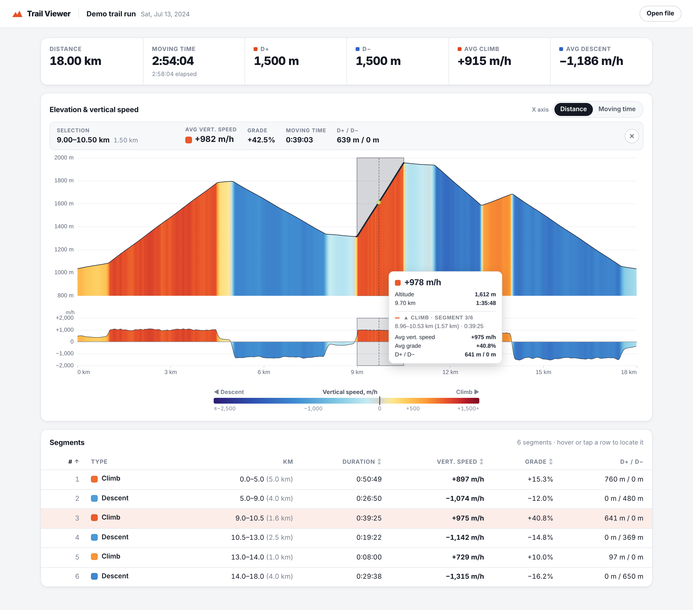

# Trail Viewer

View a trail run's elevation profile coloured by **vertical speed**: climbs in warm colours, descents in cool colours, with darker shades for faster ascent or descent.



Load the file exported from Garmin Connect (`.zip` or `.fit`), or try the built-in demo activity. Everything runs in your browser; nothing is uploaded.

## Features
- Elevation profile coloured continuously by vertical speed (m/h)
- Vertical speed graph aligned under the profile, with synced hover
- Drag across the graphs to measure any stretch: average vertical speed, grade, time, D+/D−
- Automatic climb / descent / flat detection, with a threshold so small bumps don't break a climb up
- Timer pauses and stationary stops (aid stations) are removed from moving time and vertical speeds
- X axis in distance or moving time
- Summary using Garmin's own totals (distance, D+/D−), plus average climb and descent speed
- Sortable table of climbs and descents linked to the chart
- Light and dark mode, works on phones

## Getting a FIT file from Garmin Connect
Open the activity → ⚙️ (top right) → **Export File** (the original FIT file, inside a `.zip`). Load the downloaded `.zip` directly, no need to unzip, on desktop or phone.

## Live app
https://rfibigr.github.io/trail-viewer/ (deployed automatically from `main` by GitHub Actions)

## Development
```bash
npm install
npm run dev        # http://localhost:5173
npm test           # unit tests (vitest)
npm run build      # type-check + production build into dist/
```

## Architecture
```
src/types/     shared data contracts
src/fit/       FIT bytes -> Activity        (@garmin/fitsdk; demo activity generator)
src/analysis/  Activity -> AnalysisResult   (pauses, smoothing, vertical speed, segmentation)
src/ui/        React + ECharts viewer
```
